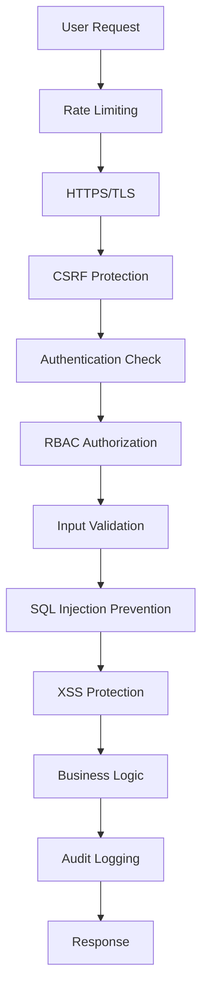

# 22. Hệ thống Security & Audit Trail

Hệ thống được trang bị các cơ chế bảo mật toàn diện và audit trail để theo dõi mọi hành động quan trọng, phát hiện các mối đe dọa và đảm bảo tuân thủ quy định.

---

## 22.1. Kiến trúc Security Layers



---

## 22.2. Audit Log System

### Model: AuditLog

```prisma
model AuditLog {
  id        String   @id @default(uuid())
  userId    String?
  event     String
  details   Json?
  ipAddress String
  userAgent String?
  success   Boolean
  createdAt DateTime @default(now())

  @@index([userId, createdAt])
  @@index([event, createdAt])
  @@index([ipAddress, createdAt])
}
```

### Các Event được log

| Event | Khi nào log | Details |
|-------|------------|---------|
| `USER_REGISTER` | User đăng ký mới | email |
| `USER_LOGIN` | Login thành công | provider, method |
| `USER_LOGOUT` | User logout | - |
| `PASSWORD_RESET` | Reset mật khẩu | method |
| `LICENSE_ACTIVATED` | Kích hoạt license | code, durationDays |
| `LICENSE_GENERATED` | Admin tạo license | count, durationDays |
| `EXAM_STARTED` | Bắt đầu thi | examId, title |
| `EXAM_SUBMITTED` | Nộp bài thi | examId, score |
| `QUESTION_IMPORTED` | Import câu hỏi | count, source |
| `QUESTION_DELETED` | Xóa câu hỏi | questionId |
| `USER_LOCKED` | Admin khóa user | targetUserId, reason |
| `USER_UNLOCKED` | Admin mở khóa user | targetUserId |
| `ADMIN_ACTION` | Hành động admin nguy hiểm | action, target |

### Service: AuditLogger

```typescript
// File: src/lib/audit.ts
import { prisma } from "./prisma";

interface AuditLogParams {
  userId?: string;
  event: string;
  details?: any;
  ipAddress: string;
  userAgent?: string;
  success: boolean;
}

export async function logAudit(params: AuditLogParams) {
  try {
    await prisma.auditLog.create({
      data: {
        userId: params.userId,
        event: params.event,
        details: params.details || {},
        ipAddress: params.ipAddress,
        userAgent: params.userAgent,
        success: params.success
      }
    });
  } catch (error) {
    // Không để lỗi audit log làm crash app
    console.error("Failed to write audit log:", error);
  }
}

// Helper để lấy IP từ request
export function getClientIP(request: Request): string {
  const forwarded = request.headers.get("x-forwarded-for");
  const realIP = request.headers.get("x-real-ip");
  
  if (forwarded) {
    return forwarded.split(",")[0].trim();
  }
  
  if (realIP) {
    return realIP;
  }
  
  return "unknown";
}

// Helper để lấy User Agent
export function getUserAgent(request: Request): string {
  return request.headers.get("user-agent") || "unknown";
}
```

### Sử dụng Audit Log

```typescript
// Trong API route
import { logAudit, getClientIP, getUserAgent } from "@/lib/audit";

export async function POST(request: Request) {
  const session = await auth();
  
  try {
    // ... business logic ...
    
    await logAudit({
      userId: session?.user?.id,
      event: "LICENSE_ACTIVATED",
      details: {
        licenseCode: code,
        durationDays: license.durationDays
      },
      ipAddress: getClientIP(request),
      userAgent: getUserAgent(request),
      success: true
    });
    
    return Response.json({ success: true });
    
  } catch (error) {
    await logAudit({
      userId: session?.user?.id,
      event: "LICENSE_ACTIVATED",
      details: { error: error.message },
      ipAddress: getClientIP(request),
      userAgent: getUserAgent(request),
      success: false
    });
    
    throw error;
  }
}
```

---

## 22.3. Login Attempt Tracking

### Model: LoginAttempt

```prisma
model LoginAttempt {
  id         String   @id @default(uuid())
  userId     String?
  email      String
  ipAddress  String
  userAgent  String?
  success    Boolean
  failReason String?
  createdAt  DateTime @default(now())

  @@index([email, createdAt])
  @@index([ipAddress, createdAt])
  @@index([userId, createdAt])
}
```

### Service: Login Tracking

```typescript
// File: src/lib/security.ts
import { prisma } from "./prisma";

export async function trackLoginAttempt(params: {
  email: string;
  ipAddress: string;
  userAgent: string;
  success: boolean;
  userId?: string;
  failReason?: string;
}) {
  await prisma.loginAttempt.create({
    data: {
      userId: params.userId,
      email: params.email,
      ipAddress: params.ipAddress,
      userAgent: params.userAgent,
      success: params.success,
      failReason: params.failReason
    }
  });
}

// Phát hiện Brute-force attack
export async function detectBruteForce(
  email: string,
  ipAddress: string
): Promise<{ isBlocked: boolean; reason?: string }> {
  const now = new Date();
  const fiveMinutesAgo = new Date(now.getTime() - 5 * 60 * 1000);

  // Đếm failed attempts theo email
  const emailFailures = await prisma.loginAttempt.count({
    where: {
      email,
      success: false,
      createdAt: { gte: fiveMinutesAgo }
    }
  });

  if (emailFailures >= 5) {
    return {
      isBlocked: true,
      reason: "Too many failed login attempts for this email"
    };
  }

  // Đếm failed attempts theo IP
  const ipFailures = await prisma.loginAttempt.count({
    where: {
      ipAddress,
      success: false,
      createdAt: { gte: fiveMinutesAgo }
    }
  });

  if (ipFailures >= 10) {
    return {
      isBlocked: true,
      reason: "Too many failed login attempts from this IP"
    };
  }

  return { isBlocked: false };
}

// Phát hiện Credential Stuffing
export async function detectCredentialStuffing(
  ipAddress: string
): Promise<boolean> {
  const oneHourAgo = new Date(Date.now() - 60 * 60 * 1000);
  
  // Đếm số email khác nhau từ cùng 1 IP
  const uniqueEmails = await prisma.loginAttempt.findMany({
    where: {
      ipAddress,
      createdAt: { gte: oneHourAgo }
    },
    select: { email: true },
    distinct: ["email"]
  });

  // Nếu > 20 email khác nhau trong 1 giờ = Credential Stuffing
  return uniqueEmails.length > 20;
}
```

---

## 22.4. Rate Limiting

### Implementation với Upstash Redis

```typescript
// File: src/lib/ratelimit.ts
import { Ratelimit } from "@upstash/ratelimit";
import { Redis } from "@upstash/redis";

const redis = new Redis({
  url: process.env.UPSTASH_REDIS_REST_URL!,
  token: process.env.UPSTASH_REDIS_REST_TOKEN!
});

// API Rate Limit: 60 requests / 1 phút
export const apiLimiter = new Ratelimit({
  redis,
  limiter: Ratelimit.slidingWindow(60, "1 m"),
  prefix: "ratelimit:api"
});

// Login Rate Limit: 5 attempts / 5 phút
export const loginLimiter = new Ratelimit({
  redis,
  limiter: Ratelimit.slidingWindow(5, "5 m"),
  prefix: "ratelimit:login"
});

// Admin Action Rate Limit: 100 requests / 1 phút
export const adminLimiter = new Ratelimit({
  redis,
  limiter: Ratelimit.slidingWindow(100, "1 m"),
  prefix: "ratelimit:admin"
});

// Helper function
export async function checkRateLimit(
  identifier: string,
  limiter: Ratelimit
): Promise<{ success: boolean; remaining: number }> {
  const { success, limit, remaining, reset } = await limiter.limit(identifier);
  
  if (!success) {
    return { success: false, remaining: 0 };
  }
  
  return { success: true, remaining };
}
```

### Middleware Rate Limit

```typescript
// File: src/lib/api-middleware.ts
import { NextResponse } from "next/server";
import { apiLimiter, checkRateLimit } from "./ratelimit";

export async function withRateLimit(
  request: Request,
  handler: () => Promise<Response>
) {
  const ip = request.headers.get("x-forwarded-for") || "unknown";
  
  const { success, remaining } = await checkRateLimit(ip, apiLimiter);
  
  if (!success) {
    return NextResponse.json(
      {
        success: false,
        error: "RATE_LIMIT_EXCEEDED",
        message: "Quá nhiều requests. Vui lòng thử lại sau."
      },
      {
        status: 429,
        headers: {
          "X-RateLimit-Remaining": "0",
          "Retry-After": "60"
        }
      }
    );
  }
  
  const response = await handler();
  
  // Thêm rate limit headers
  response.headers.set("X-RateLimit-Remaining", remaining.toString());
  
  return response;
}
```

---

## 22.5. Input Validation & Sanitization

### Zod Schema Validation

```typescript
// File: src/features/questions/schemas/question-schema.ts
import { z } from "zod";
import DOMPurify from "isomorphic-dompurify";

// Custom sanitizer cho HTML content
const sanitizeHTML = (html: string) => {
  return DOMPurify.sanitize(html, {
    ALLOWED_TAGS: ["p", "br", "strong", "em", "u", "ol", "ul", "li"],
    ALLOWED_ATTR: []
  });
};

export const createQuestionSchema = z.object({
  content: z.string()
    .min(10, "Nội dung câu hỏi phải có ít nhất 10 ký tự")
    .max(5000, "Nội dung câu hỏi không được quá 5000 ký tự")
    .transform(sanitizeHTML),
  
  explanation: z.string()
    .max(2000, "Giải thích không được quá 2000 ký tự")
    .transform(sanitizeHTML)
    .optional(),
  
  difficulty: z.enum(["EASY", "MEDIUM", "HARD"]),
  
  categoryId: z.string().uuid("Category ID không hợp lệ"),
  
  choices: z.array(
    z.object({
      content: z.string()
        .min(1, "Nội dung lựa chọn không được để trống")
        .max(1000)
        .transform(sanitizeHTML),
      isCorrect: z.boolean()
    })
  )
  .length(4, "Phải có đúng 4 lựa chọn")
  .refine(
    (choices) => choices.filter(c => c.isCorrect).length === 1,
    "Phải có đúng 1 đáp án đúng"
  )
});
```

### SQL Injection Prevention

Prisma ORM tự động parameterize queries, nhưng với raw queries cần cẩn thận:

```typescript
// ❌ KHÔNG AN TOÀN
const categoryId = request.query.categoryId;
const questions = await prisma.$queryRaw`
  SELECT * FROM "Question" WHERE "categoryId" = ${categoryId}
`;

// ✅ AN TOÀN - Prisma tự động escape
const questions = await prisma.question.findMany({
  where: { categoryId }
});

// ✅ AN TOÀN với raw query - sử dụng tagged template
const questions = await prisma.$queryRaw`
  SELECT * FROM "Question" 
  WHERE "categoryId" = ${categoryId}
  AND "difficulty" = ${difficulty}
`;
```

---

## 22.6. XSS Protection

### Content Security Policy (CSP)

```typescript
// File: next.config.ts
const securityHeaders = [
  {
    key: "Content-Security-Policy",
    value: [
      "default-src 'self'",
      "script-src 'self' 'unsafe-eval' 'unsafe-inline'",
      "style-src 'self' 'unsafe-inline'",
      "img-src 'self' data: https:",
      "font-src 'self' data:",
      "connect-src 'self'",
      "frame-ancestors 'none'",
      "base-uri 'self'",
      "form-action 'self'"
    ].join("; ")
  },
  {
    key: "X-Content-Type-Options",
    value: "nosniff"
  },
  {
    key: "X-Frame-Options",
    value: "DENY"
  },
  {
    key: "X-XSS-Protection",
    value: "1; mode=block"
  },
  {
    key: "Referrer-Policy",
    value: "strict-origin-when-cross-origin"
  },
  {
    key: "Permissions-Policy",
    value: "camera=(), microphone=(), geolocation=()"
  }
];

export default {
  async headers() {
    return [
      {
        source: "/:path*",
        headers: securityHeaders
      }
    ];
  }
};
```

### React XSS Protection

```tsx
// ✅ React tự động escape
<div>{userInput}</div>

// ⚠️ Nguy hiểm - chỉ dùng với content đã sanitize
<div dangerouslySetInnerHTML={{ __html: sanitizedHTML }} />

// ✅ Sanitize trước khi render
import DOMPurify from "dompurify";

function QuestionContent({ html }: { html: string }) {
  const sanitized = DOMPurify.sanitize(html, {
    ALLOWED_TAGS: ["p", "br", "strong", "em"],
    ALLOWED_ATTR: []
  });
  
  return <div dangerouslySetInnerHTML={{ __html: sanitized }} />;
}
```

---

## 22.7. CSRF Protection

NextAuth.js tự động bảo vệ CSRF thông qua:
- CSRF tokens trong forms
- SameSite cookies
- Origin validation

```typescript
// Cookies được set với SameSite
// File: auth.ts
export const { handlers, auth } = NextAuth({
  cookies: {
    sessionToken: {
      name: `__Secure-next-auth.session-token`,
      options: {
        httpOnly: true,
        sameSite: "lax",
        path: "/",
        secure: process.env.NODE_ENV === "production"
      }
    }
  }
});
```

---

## 22.8. Sensitive Data Protection

### Environment Variables

```env
# ❌ KHÔNG commit vào Git
DATABASE_URL=postgresql://...
NEXTAUTH_SECRET=...
GOOGLE_CLIENT_SECRET=...

# ✅ Sử dụng .env.local cho development
# ✅ Sử dụng Vercel Environment Variables cho production
```

### Password Hashing

```typescript
import bcrypt from "bcryptjs";

// Hash với cost factor = 12
const hashedPassword = await bcrypt.hash(password, 12);

// ❌ KHÔNG log passwords
console.log("Password:", password); // NGUY HIỂM

// ✅ Log safe data
console.log("User registered:", { email, name });
```

### Data Masking trong Logs

```typescript
// File: src/lib/logger.ts
export function maskSensitiveData(data: any): any {
  const masked = { ...data };
  
  const sensitiveFields = [
    "password",
    "token",
    "secret",
    "apiKey",
    "accessToken",
    "refreshToken"
  ];
  
  for (const field of sensitiveFields) {
    if (masked[field]) {
      masked[field] = "***MASKED***";
    }
  }
  
  return masked;
}

// Sử dụng
const user = { email: "test@example.com", password: "secret123" };
logger.info("User data:", maskSensitiveData(user));
// Output: { email: "test@example.com", password: "***MASKED***" }
```

---

## 22.9. Security Monitoring & Alerts

### Real-time Security Alerts

```typescript
// File: src/lib/security-alerts.ts
import { sendAdminAlert } from "./email";

export async function alertSecurityEvent(event: {
  type: "BRUTE_FORCE" | "CREDENTIAL_STUFFING" | "SUSPICIOUS_ACTIVITY";
  details: any;
}) {
  // Gửi email cho admin
  await sendAdminAlert({
    subject: `🚨 Security Alert: ${event.type}`,
    body: JSON.stringify(event.details, null, 2)
  });
  
  // Log vào audit
  await logAudit({
    event: "SECURITY_ALERT",
    details: event,
    ipAddress: "system",
    success: true
  });
}

// Tự động phát hiện và alert
export async function checkSecurityThreats() {
  // Kiểm tra brute-force
  const recentFailures = await prisma.loginAttempt.groupBy({
    by: ["ipAddress"],
    where: {
      success: false,
      createdAt: { gte: new Date(Date.now() - 10 * 60 * 1000) }
    },
    _count: true,
    having: {
      ipAddress: { _count: { gt: 20 } }
    }
  });
  
  for (const threat of recentFailures) {
    await alertSecurityEvent({
      type: "BRUTE_FORCE",
      details: {
        ipAddress: threat.ipAddress,
        attemptCount: threat._count
      }
    });
  }
}
```

---

## 22.10. Admin Security Dashboard

### API: `/api/admin/security/dashboard`

```typescript
export async function GET() {
  const session = await requireAdmin();
  
  const now = new Date();
  const last24h = new Date(now.getTime() - 24 * 60 * 60 * 1000);
  
  const stats = {
    // Failed logins trong 24h
    failedLogins: await prisma.loginAttempt.count({
      where: {
        success: false,
        createdAt: { gte: last24h }
      }
    }),
    
    // Unique IPs failed
    suspiciousIPs: await prisma.loginAttempt.groupBy({
      by: ["ipAddress"],
      where: {
        success: false,
        createdAt: { gte: last24h }
      },
      _count: true,
      having: {
        ipAddress: { _count: { gt: 5 } }
      }
    }),
    
    // Recent audit events
    recentEvents: await prisma.auditLog.findMany({
      where: {
        createdAt: { gte: last24h }
      },
      orderBy: { createdAt: "desc" },
      take: 100
    }),
    
    // Security alerts
    alerts: await prisma.auditLog.count({
      where: {
        event: "SECURITY_ALERT",
        createdAt: { gte: last24h }
      }
    })
  };
  
  return Response.json({ success: true, data: stats });
}
```

---

## 22.11. Security Checklist

### Development
- ✅ Sử dụng HTTPS (TLS 1.3)
- ✅ Environment variables không commit vào Git
- ✅ Dependencies được audit thường xuyên (`npm audit`)
- ✅ Secrets rotation định kỳ
- ✅ Code review cho mọi PR

### Authentication
- ✅ Password hashing với bcrypt (cost 12)
- ✅ JWT tokens trong httpOnly cookies
- ✅ Session expiration (30 ngày)
- ✅ Rate limiting cho login (5/5min)
- ✅ Brute-force detection

### Authorization
- ✅ RBAC enforcement ở mọi endpoint
- ✅ Middleware validation
- ✅ License expiration check
- ✅ Admin actions require confirmation

### Data Protection
- ✅ Input validation với Zod
- ✅ SQL injection prevention (Prisma)
- ✅ XSS protection (CSP + DOMPurify)
- ✅ CSRF protection (NextAuth)
- ✅ Sensitive data masking trong logs

### Monitoring
- ✅ Audit log mọi hành động quan trọng
- ✅ Track login attempts
- ✅ Security alerts real-time
- ✅ Admin security dashboard
- ✅ Regular security audits

