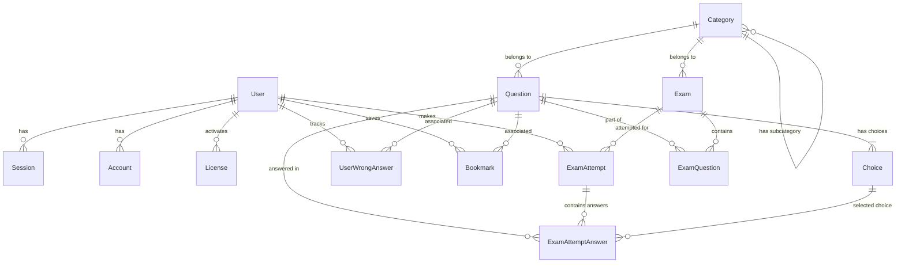

# 05. Thiết kế Cơ sở dữ liệu (Database Design)

Hệ thống sử dụng cơ sở dữ liệu quan hệ PostgreSQL làm lưu trữ chính. Dưới đây là lược đồ thiết kế thực thể cơ sở dữ liệu chi tiết và schema Prisma tương thích.

---

## 5.1. Sơ đồ quan hệ thực thể (ERD - Entity Relationship Diagram)



---

## 5.2. Mô tả các bảng dữ liệu (Data Dictionary)

### 1. Bảng `User` (Thông tin người dùng)
*   `id`: `String` (UUID, Primary Key)
*   `name`: `String` (Tên hiển thị)
*   `email`: `String` (Địa chỉ email đăng nhập, Unique)
*   `password`: `String?` (Mật khẩu đã băm, Nullable nếu dùng Google OAuth)
*   `role`: `Role` (Enum: `ADMIN`, `LEARNER`)
*   `status`: `UserStatus` (Enum: `ACTIVE`, `LOCKED`, `INACTIVE`)
*   `licenseExpiresAt`: `DateTime?` (Hạn sử dụng tài khoản, nếu Null nghĩa là chưa kích hoạt license)
*   `createdAt`, `updatedAt`: `DateTime`

### 2. Bảng `License` (Mã bản quyền / Gói dịch vụ)
*   `id`: `String` (UUID, Primary Key)
*   `code`: `String` (Mã code kích hoạt dạng duy nhất, Unique, ví dụ: `VIC-98A1-4D5E`)
*   `durationDays`: `Int` (Số ngày hiệu lực sau khi kích hoạt, ví dụ: 30, 90, 180)
*   `status`: `LicenseStatus` (Enum: `UNUSED`, `ACTIVATED`, `EXPIRED`, `REVOKED`)
*   `activatedAt`: `DateTime?` (Ngày kích hoạt)
*   `activatedByUserId`: `String?` (Mã ID người dùng kích hoạt, Foreign Key to `User`)
*   `createdAt`, `updatedAt`: `DateTime`

### 3. Bảng `Category` (Danh mục chuyên đề luật)
*   `id`: `String` (UUID, Primary Key)
*   `name`: `String` (Tên danh mục, ví dụ: "Hiến pháp 2013")
*   `description`: `String?` (Mô tả chi tiết)
*   `parentId`: `String?` (Mã cha để phân cấp sơ đồ cây danh mục, Foreign Key to `Category`)
*   `createdAt`, `updatedAt`: `DateTime`

### 4. Bảng `Question` (Ngân hàng câu hỏi)
*   `id`: `String` (UUID, Primary Key)
*   `content`: `String` (Nội dung câu hỏi, dạng Text hoặc HTML hỗ trợ chứa ảnh/bảng)
*   `explanation`: `String?` (Giải thích chi tiết đáp án đúng)
*   `difficulty`: `Difficulty` (Enum: `EASY`, `MEDIUM`, `HARD`)
*   `categoryId`: `String` (Thuộc danh mục chuyên đề nào, Foreign Key to `Category`)
*   `createdAt`, `updatedAt`: `DateTime`

**Lưu ý:** Trường `isDraft` đã được loại bỏ. Tất cả câu hỏi được thêm vào hệ thống sẽ ngay lập tức có sẵn để sử dụng trong các bài thi mà không cần phê duyệt.

### 5. Bảng `Choice` (Các phương án lựa chọn)
*   `id`: `String` (UUID, Primary Key)
*   `questionId`: `String` (Foreign Key to `Question`, xóa Cascade khi xóa Question)
*   `content`: `String` (Nội dung lựa chọn A, B, C hoặc D)
*   `isCorrect`: `Boolean` (Đánh dấu đáp án đúng, `true`/`false`)

### 6. Bảng `Exam` (Cấu trúc đề thi tĩnh hoặc ma trận đề thi)
*   `id`: `String` (UUID, Primary Key)
*   `title`: `String` (Tiêu đề đề thi)
*   `description`: `String?` (Mô tả)
*   `timeLimit`: `Int` (Thời gian thi, tính bằng giây)
*   `isPublished`: `Boolean` (Trạng thái công khai cho học viên làm bài)
*   `matrix`: `Json?` (Cấu hình tỷ lệ câu hỏi nếu là đề thi sinh tự động, ví dụ: `{"cat-1": 15, "cat-2": 15}`)
*   `categoryId`: `String?` (Liên kết chuyên đề lớn, Nullable)
*   `createdAt`, `updatedAt`: `DateTime`

### 7. Bảng `ExamQuestion` (Liên kết câu hỏi với đề thi tĩnh)
*   `examId`: `String` (Foreign Key to `Exam`, Composite Primary Key 1)
*   `questionId`: `String` (Foreign Key to `Question`, Composite Primary Key 2)
*   `sortOrder`: `Int` (Thứ tự câu hỏi hiển thị trong đề)

### 8. Bảng `ExamAttempt` (Lượt thi thử của người dùng)
*   `id`: `String` (UUID, Primary Key)
*   `userId`: `String` (Foreign Key to `User`)
*   `examId`: `String` (Foreign Key to `Exam`)
*   `score`: `Float` (Điểm số đạt được, ví dụ: 50.0 trên thang 100)
*   `correctCount`: `Int` (Số câu trả lời đúng)
*   `totalCount`: `Int` (Tổng số câu hỏi trong bài)
*   `startedAt`: `DateTime` (Thời điểm bắt đầu làm bài)
*   `submittedAt`: `DateTime?` (Thời điểm nộp bài)
*   `status`: `AttemptStatus` (Enum: `IN_PROGRESS`, `SUBMITTED`, `SYSTEM_SUBMITTED`, `ABANDONED`)

### 9. Bảng `ExamAttemptAnswer` (Chi tiết câu trả lời của lượt thi)
*   `id`: `String` (UUID, Primary Key)
*   `attemptId`: `String` (Foreign Key to `ExamAttempt`)
*   `questionId`: `String` (Foreign Key to `Question`)
*   `selectedChoiceId`: `String?` (Foreign Key to `Choice`, Nullable nếu bỏ trống không làm)
*   `isCorrect`: `Boolean` (Kết quả so khớp tại thời điểm nộp bài)

### 10. Bảng `UserWrongAnswer` (Danh sách các câu làm sai để ôn lại)
*   `id`: `String` (UUID, Primary Key)
*   `userId`: `String` (Foreign Key to `User`)
*   `questionId`: `String` (Foreign Key to `Question`)
*   `wrongCount`: `Int` (Số lần làm sai câu hỏi này, tăng dần để theo dõi độ khó đối với user)
*   `lastAnsweredAt`: `DateTime` (Lần trả lời sai gần nhất)

### 11. Bảng `Bookmark` (Đánh dấu câu hỏi)
*   `id`: `String` (UUID, Primary Key)
*   `userId`: `String` (Foreign Key to `User`)
*   `questionId`: `String` (Foreign Key to `Question`)
*   `createdAt`: `DateTime`

---

## 5.3. Định nghĩa Schema Prisma (`schema.prisma`)

```prisma
datasource db {
  provider = "postgresql"
  url      = env("DATABASE_URL")
}

generator client {
  provider = "prisma-client-js"
}

enum Role {
  ADMIN
  LEARNER
}

enum UserStatus {
  ACTIVE
  LOCKED
  INACTIVE
}

enum LicenseStatus {
  UNUSED
  ACTIVATED
  EXPIRED
  REVOKED
}

enum Difficulty {
  EASY
  MEDIUM
  HARD
}

enum AttemptStatus {
  IN_PROGRESS
  SUBMITTED
  SYSTEM_SUBMITTED
  ABANDONED
}

model User {
  id               String            @id @default(uuid())
  name             String
  email            String            @unique
  password         String?
  role             Role              @default(LEARNER)
  status           UserStatus        @default(ACTIVE)
  licenseExpiresAt DateTime?
  createdAt        DateTime          @default(now())
  updatedAt        DateTime          @updatedAt
  
  // NextAuth
  accounts         Account[]
  sessions         Session[]
  
  // Relations
  activatedLicenses License[]        @relation("ActivatedBy")
  examAttempts     ExamAttempt[]
  wrongAnswers     UserWrongAnswer[]
  bookmarks        Bookmark[]

  @@index([email])
}

model Account {
  id                 String  @id @default(uuid())
  userId             String
  type               String
  provider           String
  providerAccountId  String
  refresh_token      String?  @db.Text
  access_token       String?  @db.Text
  expires_at         Int?
  token_type         String?
  scope              String?
  id_token           String?  @db.Text
  session_state      String?

  user User @relation(fields: [userId], references: [id], onDelete: Cascade)

  @@unique([provider, providerAccountId])
}

model Session {
  id           String   @id @default(uuid())
  sessionToken String   @unique
  userId       String
  expires      DateTime
  user         User     @relation(fields: [userId], references: [id], onDelete: Cascade)
}

model VerificationToken {
  identifier String
  token      String   @unique
  expires    DateTime

  @@unique([identifier, token])
}

model License {
  id                String        @id @default(uuid())
  code              String        @unique
  durationDays      Int
  status            LicenseStatus @default(UNUSED)
  activatedAt       DateTime?
  activatedByUserId String?
  createdAt         DateTime      @default(now())
  updatedAt         DateTime      @updatedAt

  activatedBy       User?         @relation("ActivatedBy", fields: [activatedByUserId], references: [id])

  @@index([code])
}

model Category {
  id          String     @id @default(uuid())
  name        String
  description String?    @db.Text
  parentId    String?
  createdAt   DateTime   @default(now())
  updatedAt   DateTime   @updatedAt

  parent      Category?  @relation("SubCategories", fields: [parentId], references: [id])
  children    Category[] @relation("SubCategories")
  questions   Question[]
  exams       Exam[]
}

model Question {
  id          String      @id @default(uuid())
  content     String      @db.Text
  explanation String?     @db.Text
  difficulty  Difficulty  @default(MEDIUM)
  categoryId  String
  createdAt   DateTime    @default(now())
  updatedAt   DateTime    @updatedAt

  category    Category    @relation(fields: [categoryId], references: [id])
  choices     Choice[]
  
  examQuestions      ExamQuestion[]
  attemptAnswers     ExamAttemptAnswer[]
  wrongAnswers       UserWrongAnswer[]
  bookmarks          Bookmark[]

  @@index([categoryId])
}

model Choice {
  id         String   @id @default(uuid())
  questionId String
  content    String   @db.Text
  isCorrect  Boolean  @default(false)

  question   Question @relation(fields: [questionId], references: [id], onDelete: Cascade)
  attemptAnswers ExamAttemptAnswer[]
}

model Exam {
  id          String   @id @default(uuid())
  title       String
  description String?  @db.Text
  timeLimit   Int      // Đơn vị giây
  isPublished Boolean  @default(false)
  matrix      Json?    // Ví dụ cấu trúc sinh đề: [{"categoryId": "abc", "count": 10}]
  categoryId  String?
  createdAt   DateTime @default(now())
  updatedAt   DateTime @updatedAt

  category    Category? @relation(fields: [categoryId], references: [id])
  examQuestions ExamQuestion[]
  attempts      ExamAttempt[]
}

model ExamQuestion {
  examId     String
  questionId String
  sortOrder  Int

  exam       Exam     @relation(fields: [examId], references: [id], onDelete: Cascade)
  question   Question @relation(fields: [questionId], references: [id], onDelete: Cascade)

  @@id([examId, questionId])
}

model ExamAttempt {
  id           String        @id @default(uuid())
  userId       String
  examId       String
  score        Float
  correctCount Int
  totalCount   Int
  startedAt    DateTime      @default(now())
  submittedAt  DateTime?
  status       AttemptStatus @default(IN_PROGRESS)

  user         User          @relation(fields: [userId], references: [id], onDelete: Cascade)
  exam         Exam          @relation(fields: [examId], references: [id], onDelete: Cascade)
  answers      ExamAttemptAnswer[]

  @@index([userId])
  @@index([examId])
}

model ExamAttemptAnswer {
  id             String      @id @default(uuid())
  attemptId      String
  questionId     String
  selectedChoiceId String?
  isCorrect      Boolean     @default(false)

  attempt        ExamAttempt @relation(fields: [attemptId], references: [id], onDelete: Cascade)
  question       Question    @relation(fields: [questionId], references: [id], onDelete: Cascade)
  choice         Choice?     @relation(fields: [selectedChoiceId], references: [id])
}

model UserWrongAnswer {
  id             String   @id @default(uuid())
  userId         String
  questionId     String
  wrongCount     Int      @default(1)
  lastAnsweredAt DateTime @default(now())

  user           User     @relation(fields: [userId], references: [id], onDelete: Cascade)
  question       Question @relation(fields: [questionId], references: [id], onDelete: Cascade)

  @@unique([userId, questionId])
}

model Bookmark {
  id         String   @id @default(uuid())
  userId     String
  questionId String
  createdAt  DateTime @default(now())

  user       User     @relation(fields: [userId], references: [id], onDelete: Cascade)
  question   Question @relation(fields: [questionId], references: [id], onDelete: Cascade)

  @@unique([userId, questionId])
}
```
