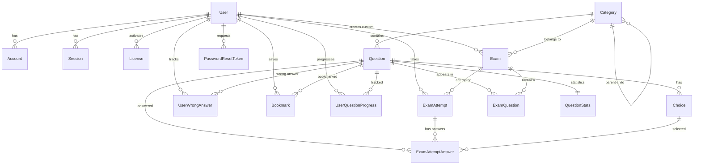

# 05. Thiết kế cơ sở dữ liệu (Database Schema Design)

Hệ thống sử dụng **PostgreSQL** làm cơ sở dữ liệu chính với **Prisma ORM** để quản lý schema và migrations. Database được thiết kế tuân thủ chuẩn hóa 3NF (Third Normal Form) đảm bảo tính toàn vẹn dữ liệu.

---

## 5.1. Sơ đồ quan hệ thực thể (Entity Relationship Diagram)



---

## 5.2. Chi tiết các Enum Types

### Role
```prisma
enum Role {
  ADMIN    // Quản trị viên - Toàn quyền
  LEARNER  // Người học - Quyền hạn chế
}
```

### UserStatus
```prisma
enum UserStatus {
  ACTIVE   // Tài khoản đang hoạt động bình thường
  LOCKED   // Bị khóa bởi Admin (vi phạm chính sách)
  INACTIVE // Chưa kích hoạt email hoặc tự nguyện vô hiệu hóa
}
```

### LicenseStatus
```prisma
enum LicenseStatus {
  UNUSED    // Mã chưa được sử dụng
  ACTIVATED // Đã kích hoạt thành công
  EXPIRED   // Đã hết hạn sử dụng
  REVOKED   // Bị thu hồi (hoàn tiền, gian lận)
}
```

### Difficulty
```prisma
enum Difficulty {
  EASY   // Câu hỏi dễ
  MEDIUM // Câu hỏi trung bình
  HARD   // Câu hỏi khó
}
```

### AttemptStatus
```prisma
enum AttemptStatus {
  IN_PROGRESS      // Đang làm bài
  SUBMITTED        // Đã nộp bài thủ công
  SYSTEM_SUBMITTED // Hệ thống tự động nộp (hết giờ)
  ABANDONED        // Bỏ dở giữa chừng
}
```

---

## 5.3. Chi tiết các Model (Database Tables)

### 5.3.1. User - Quản lý người dùng
Bảng trung tâm lưu trữ thông tin tài khoản người dùng.

| Trường | Kiểu | Mô tả |
|--------|------|-------|
| `id` | String (UUID) | Khóa chính |
| `name` | String | Tên hiển thị |
| `email` | String (unique) | Email đăng nhập |
| `password` | String? | Hash password (null nếu OAuth) |
| `role` | Role | Vai trò: ADMIN hoặc LEARNER |
| `status` | UserStatus | Trạng thái tài khoản |
| `licenseExpiresAt` | DateTime? | Ngày hết hạn license |
| `level` | Int | Cấp độ gamification (default: 1) |
| `xp` | Int | Điểm kinh nghiệm (default: 0) |
| `streak` | Int | Chuỗi ngày học liên tục (default: 0) |
| `lastActiveDate` | DateTime? | Ngày hoạt động gần nhất |
| `badges` | String[] | Danh sách huy hiệu đạt được |
| `createdAt` | DateTime | Ngày tạo tài khoản |
| `updatedAt` | DateTime | Ngày cập nhật cuối |

**Indexes:**
- `@@index([email])` - Tối ưu tra cứu login

**Relations:**
- `accounts`: Liên kết OAuth providers (NextAuth)
- `sessions`: Session management (NextAuth)
- `activatedLicenses`: Lịch sử kích hoạt license
- `examAttempts`: Các lượt thi đã làm
- `wrongAnswers`: Kho câu hỏi làm sai
- `bookmarks`: Câu hỏi yêu thích
- `customExams`: Đề thi tự tạo
- `questionProgress`: Tiến trình học từng câu hỏi
- `passwordResetTokens`: Token reset mật khẩu

---

### 5.3.2. Account - OAuth Provider Linking (NextAuth)
Lưu thông tin liên kết các OAuth provider (Google, Facebook, v.v.).

| Trường | Kiểu | Mô tả |
|--------|------|-------|
| `id` | String (UUID) | Khóa chính |
| `userId` | String | FK -> User.id |
| `type` | String | Loại provider (oauth, credentials) |
| `provider` | String | Tên provider (google, facebook) |
| `providerAccountId` | String | ID tài khoản tại provider |
| `refresh_token` | String? | Refresh token OAuth |
| `access_token` | String? | Access token OAuth |
| `expires_at` | Int? | Thời gian hết hạn token |
| `token_type` | String? | Loại token (Bearer) |
| `scope` | String? | Phạm vi quyền truy cập |
| `id_token` | String? | ID token JWT |
| `session_state` | String? | Trạng thái session |

**Unique Constraint:**
- `@@unique([provider, providerAccountId])` - Mỗi account chỉ link 1 lần

---

### 5.3.3. Session - Session Management (NextAuth)
Quản lý phiên đăng nhập của người dùng.

| Trường | Kiểu | Mô tả |
|--------|------|-------|
| `id` | String (UUID) | Khóa chính |
| `sessionToken` | String (unique) | Token định danh session |
| `userId` | String | FK -> User.id |
| `expires` | DateTime | Thời điểm hết hạn session |

---

### 5.3.4. VerificationToken - Email Verification
Token xác thực email khi đăng ký mới.

| Trường | Kiểu | Mô tả |
|--------|------|-------|
| `identifier` | String | Email hoặc user ID |
| `token` | String (unique) | Token ngẫu nhiên |
| `expires` | DateTime | Thời điểm hết hạn |

**Unique Constraint:**
- `@@unique([identifier, token])`

---

### 5.3.5. PasswordResetToken - Quên mật khẩu
Quản lý token reset mật khẩu.

| Trường | Kiểu | Mô tả |
|--------|------|-------|
| `id` | String (UUID) | Khóa chính |
| `userId` | String | FK -> User.id |
| `token` | String (unique) | Token reset ngẫu nhiên |
| `expires` | DateTime | Thời điểm hết hạn (thường 1 giờ) |
| `createdAt` | DateTime | Ngày tạo token |

**Indexes:**
- `@@index([userId])`
- `@@index([token])`

---

### 5.3.6. LoginAttempt - Tracking đăng nhập
Ghi lại mọi lần đăng nhập (thành công/thất bại) để phát hiện tấn công brute-force.

| Trường | Kiểu | Mô tả |
|--------|------|-------|
| `id` | String (UUID) | Khóa chính |
| `userId` | String? | FK -> User.id (null nếu fail) |
| `email` | String | Email thử đăng nhập |
| `ipAddress` | String | IP address nguồn |
| `userAgent` | String? | Browser user agent |
| `success` | Boolean | Thành công hay thất bại |
| `failReason` | String? | Lý do thất bại (wrong password, locked) |
| `createdAt` | DateTime | Thời điểm đăng nhập |

**Indexes:**
- `@@index([email, createdAt])` - Đếm số lần fail theo email
- `@@index([ipAddress, createdAt])` - Phát hiện IP tấn công
- `@@index([userId, createdAt])` - Lịch sử login của user

---

### 5.3.7. AuditLog - Nhật ký hệ thống
Ghi lại mọi hành động quan trọng trong hệ thống (audit trail).

| Trường | Kiểu | Mô tả |
|--------|------|-------|
| `id` | String (UUID) | Khóa chính |
| `userId` | String? | FK -> User.id |
| `event` | String | Tên sự kiện (USER_LOGIN, LICENSE_ACTIVATED) |
| `details` | Json? | Chi tiết sự kiện (object JSON) |
| `ipAddress` | String | IP thực hiện hành động |
| `userAgent` | String? | Browser user agent |
| `success` | Boolean | Hành động thành công/thất bại |
| `createdAt` | DateTime | Thời điểm xảy ra sự kiện |

**Indexes:**
- `@@index([userId, createdAt])`
- `@@index([event, createdAt])`
- `@@index([ipAddress, createdAt])`

**Các event thường gặp:**
- `USER_REGISTER`, `USER_LOGIN`, `USER_LOGOUT`
- `LICENSE_ACTIVATED`, `LICENSE_GENERATED`
- `EXAM_STARTED`, `EXAM_SUBMITTED`
- `QUESTION_IMPORTED`, `QUESTION_DELETED`
- `USER_LOCKED`, `USER_UNLOCKED`

---

### 5.3.8. RecruitmentPost - Tin tuyển dụng
Quản lý thông tin tuyển dụng công chức, viên chức.

| Trường | Kiểu | Mô tả |
|--------|------|-------|
| `id` | String (UUID) | Khóa chính |
| `title` | String | Tiêu đề tin tuyển dụng |
| `organization` | String | Tên cơ quan tuyển dụng |
| `position` | String | Vị trí tuyển dụng |
| `quantity` | Int | Số lượng tuyển |
| `location` | String | Địa điểm làm việc |
| `registrationUrl` | String? | Link đăng ký online |
| `startDate` | DateTime | Ngày bắt đầu nhận hồ sơ |
| `endDate` | DateTime | Ngày kết thúc |
| `description` | String? | Mô tả chi tiết |
| `requirements` | String? | Yêu cầu ứng viên |
| `benefits` | String? | Quyền lợi |
| `isActive` | Boolean | Còn hiển thị hay không |
| `viewCount` | Int | Số lượt xem (default: 0) |
| `createdAt` | DateTime | Ngày đăng tin |
| `updatedAt` | DateTime | Ngày cập nhật cuối |

**Indexes:**
- `@@index([isActive, endDate])` - Lọc tin còn hạn
- `@@index([createdAt])` - Sắp xếp theo mới nhất

---

