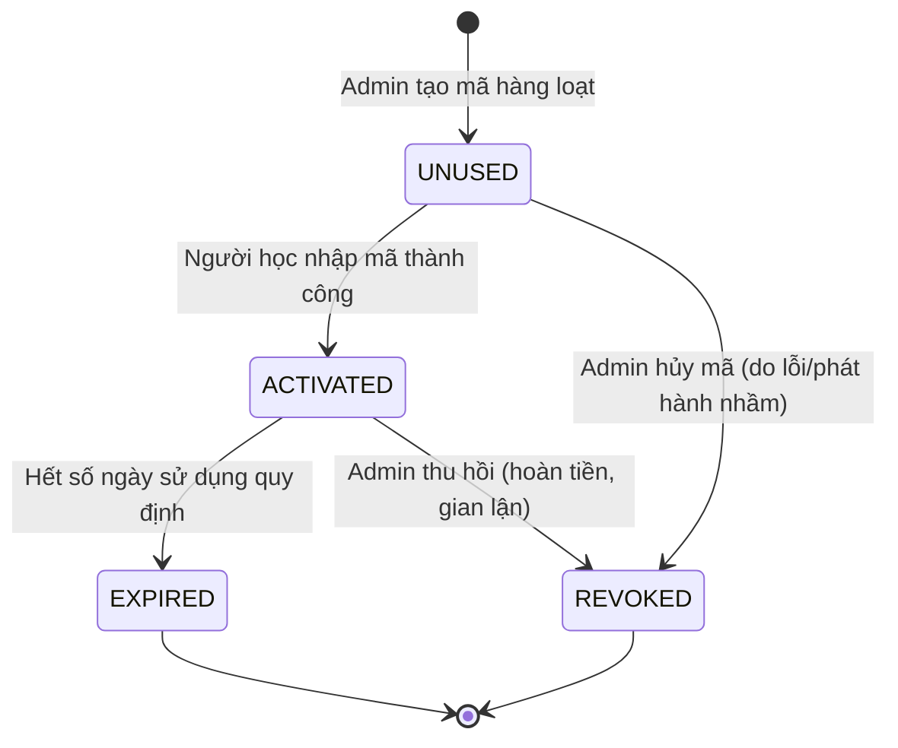

# 08. Hệ thống License & Kích hoạt gói dịch vụ (License System)

Hệ thống cung cấp cơ chế thương mại hóa thông qua **Mã kích hoạt bản quyền (License Code)**. Người dùng sau khi đăng ký tài khoản cần nhập mã này để mở khóa thời hạn ôn tập tương ứng.

---

## 8.1. Vòng đời của một License (License Lifecycle)

Một mã License di chuyển qua các trạng thái sau:



---

## 8.2. Thuật toán phát sinh mã License (Generation Algorithm)

Mã License phải vừa đảm bảo tính ngẫu nhiên (bảo mật, chống đoán mò), vừa dễ nhìn và nhập liệu cho người dùng.
*   **Định dạng chuẩn:** `VIC-XXXX-XXXX-XXXX` (với X là ký tự chữ in hoa từ A-Z hoặc số từ 2-9 để tránh gây nhầm lẫn như chữ `O` và số `0`, chữ `I` và số `1`).
*   **Thư viện phát sinh:** Sử dụng module `crypto` có sẵn trong Node.js để sinh chuỗi ngẫu nhiên có độ bảo mật cao.

```typescript
import crypto from "crypto";

export function generateLicenseCode(): string {
  const chars = "23456789ABCDEFGHJKLMNPQRSTUVWXYZ"; // Loại bỏ 0, 1, O, I, v.v.
  const segmentLength = 4;
  const numSegments = 3;
  let code = "VIC";

  for (let i = 0; i < numSegments; i++) {
    let segment = "";
    for (let j = 0; j < segmentLength; j++) {
      const randomIndex = crypto.randomInt(0, chars.length);
      segment += chars.charAt(randomIndex);
    }
    code += `-${segment}`;
  }
  
  return code; // Ví dụ: VIC-A3B4-9F8G-LK2H
}
```

---

## 8.3. Quy trình kích hoạt & Cộng dồn thời hạn (Activation Workflow)

Quy trình kích hoạt License được thực hiện thông qua một **Prisma Database Transaction** để đảm bảo tính nhất quán của dữ liệu (ACID), tránh trường hợp mã được sử dụng đồng thời hai lần.

### Cơ chế cộng dồn thời hạn (License Stacking)
Nếu tài khoản người dùng vẫn còn thời hạn (chưa hết hạn):
$$\text{Hạn mới} = \text{Hạn cũ hiện tại} + \text{Thời hạn của License mới}$$
Nếu tài khoản người dùng chưa kích hoạt hoặc đã hết hạn:
$$\text{Hạn mới} = \text{Thời điểm hiện tại} + \text{Thời hạn của License mới}$$

### Mã nguồn xử lý kích hoạt (Service Layer Code)
```typescript
import { prisma } from "@/lib/prisma";

export async function activateLicense(userId: string, code: string) {
  return await prisma.$transaction(async (tx) => {
    // 1. Tìm kiếm và khóa dòng License để tránh tranh chấp (Row Lock)
    const license = await tx.license.findUnique({
      where: { code }
    });

    if (!license) {
      throw new Error("Mã kích hoạt không tồn tại trên hệ thống.");
    }

    if (license.status !== "UNUSED") {
      throw new Error("Mã kích hoạt này đã được sử dụng hoặc bị vô hiệu hóa.");
    }

    // 2. Lấy thông tin user hiện tại
    const user = await tx.user.findUnique({
      where: { id: userId }
    });

    if (!user) {
      throw new Error("Người dùng không tồn tại.");
    }

    const now = new Date();
    let newExpiration: Date;

    // 3. Tính toán thời hạn mới (Cơ chế cộng dồn)
    if (user.licenseExpiresAt && user.licenseExpiresAt > now) {
      newExpiration = new Date(
        user.licenseExpiresAt.getTime() + license.durationDays * 24 * 60 * 60 * 1000
      );
    } else {
      newExpiration = new Date(
        now.getTime() + license.durationDays * 24 * 60 * 60 * 1000
      );
    }

    // 4. Cập nhật trạng thái License
    await tx.license.update({
      where: { id: license.id },
      data: {
        status: "ACTIVATED",
        activatedAt: now,
        activatedByUserId: userId
      }
    });

    // 5. Cập nhật hạn dùng của User
    const updatedUser = await tx.user.update({
      where: { id: userId },
      data: {
        licenseExpiresAt: newExpiration
      }
    });

    return {
      licenseExpiresAt: updatedUser.licenseExpiresAt,
      durationDays: license.durationDays
    };
  });
}
```

---

## 8.4. Đồng bộ hóa & Quét dọn tự động (Cron Maintenance)

Mặc dù việc phân quyền dựa trên hạn dùng là lười (lazy check - so sánh trực tiếp ngày hiện tại và `licenseExpiresAt` lúc đăng nhập), chúng ta vẫn chạy một tiến trình kiểm tra định kỳ (Cron Job) hàng ngày để dọn dẹp và cập nhật trạng thái bảng `License` nhằm phục vụ báo cáo thống kê chính xác:

*   **Thời gian chạy:** 00:00 hàng ngày.
*   **Nhiệm vụ:** Tìm các License có trạng thái `ACTIVATED` nhưng đã qua ngày hết hạn (căn cứ vào `activatedAt` + `durationDays` < `now`) và cập nhật `status = EXPIRED`.
