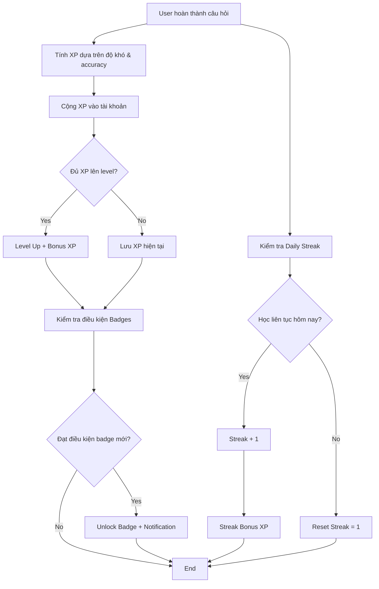

# 21. Hệ thống Gamification & Động lực học tập

Hệ thống gamification được thiết kế để tăng cường động lực học tập thông qua **XP (Experience Points)**, **Level**, **Streak**, **Badges** và **Spaced Repetition Algorithm**.

---

## 21.1. Tổng quan các yếu tố Gamification



---

## 21.2. Level & Experience Points (XP)

### Công thức tính XP khi trả lời câu hỏi

```typescript
function calculateXP(
  difficulty: "EASY" | "MEDIUM" | "HARD",
  isCorrect: boolean,
  timeSpent: number, // giây
  expectedTime: number = 60 // giây
): number {
  // Base XP theo độ khó
  const baseXP = {
    EASY: 10,
    MEDIUM: 15,
    HARD: 25
  }[difficulty];

  // Penalty nếu sai
  if (!isCorrect) {
    return Math.floor(baseXP * 0.1); // Chỉ được 10% XP
  }

  // Speed bonus (nếu trả lời nhanh hơn expected time)
  let speedMultiplier = 1.0;
  if (timeSpent < expectedTime * 0.5) {
    speedMultiplier = 1.5; // +50% nếu trả lời trong < 30s
  } else if (timeSpent < expectedTime * 0.75) {
    speedMultiplier = 1.25; // +25% nếu < 45s
  }

  return Math.floor(baseXP * speedMultiplier);
}
```

### Công thức Level Up

```typescript
function getRequiredXPForLevel(level: number): number {
  // XP cần thiết tăng theo cấp số nhân
  return Math.floor(100 * Math.pow(1.5, level - 1));
}

// Ví dụ:
// Level 1 -> 2: 100 XP
// Level 2 -> 3: 150 XP
// Level 3 -> 4: 225 XP
// Level 4 -> 5: 337 XP
// Level 5 -> 6: 506 XP
```

### Cập nhật XP sau khi làm bài

```typescript
// File: src/features/gamification/services/xp-service.ts
import { prisma } from "@/lib/prisma";

export async function addXP(
  userId: string,
  xpAmount: number,
  reason: string
) {
  return await prisma.$transaction(async (tx) => {
    // Lấy user hiện tại
    const user = await tx.user.findUnique({
      where: { id: userId },
      select: { level: true, xp: true }
    });

    if (!user) throw new Error("User not found");

    const newXP = user.xp + xpAmount;
    const requiredXP = getRequiredXPForLevel(user.level + 1);

    let newLevel = user.level;
    let finalXP = newXP;

    // Kiểm tra level up
    if (newXP >= requiredXP) {
      newLevel = user.level + 1;
      finalXP = newXP - requiredXP; // XP dư chuyển sang level mới
      
      // Bonus XP khi level up
      finalXP += 50;
    }

    // Update user
    const updatedUser = await tx.user.update({
      where: { id: userId },
      data: {
        xp: finalXP,
        level: newLevel
      }
    });

    // Ghi audit log
    await tx.auditLog.create({
      data: {
        userId,
        event: newLevel > user.level ? "LEVEL_UP" : "XP_GAINED",
        details: {
          xpGained: xpAmount,
          reason,
          newLevel,
          newXP: finalXP
        },
        ipAddress: "system",
        success: true
      }
    });

    return {
      leveledUp: newLevel > user.level,
      newLevel,
      newXP: finalXP,
      xpGained: xpAmount
    };
  });
}
```

---

## 21.3. Daily Streak System

### Cơ chế hoạt động

- User phải học **ít nhất 1 câu hỏi/ngày** để duy trì streak
- Nếu bỏ qua 1 ngày → Streak reset về 1
- Streak càng cao → Bonus XP càng lớn

### Công thức Streak Bonus

```typescript
function getStreakBonus(streak: number): number {
  if (streak < 3) return 0;
  if (streak < 7) return 5;   // 3-6 ngày: +5 XP/câu
  if (streak < 14) return 10;  // 7-13 ngày: +10 XP/câu
  if (streak < 30) return 15;  // 14-29 ngày: +15 XP/câu
  return 25;                    // 30+ ngày: +25 XP/câu
}
```

### Cập nhật Daily Streak

```typescript
// File: src/features/gamification/services/streak-service.ts
export async function updateStreak(userId: string) {
  const user = await prisma.user.findUnique({
    where: { id: userId },
    select: { streak: true, lastActiveDate: true }
  });

  if (!user) return;

  const today = new Date();
  today.setHours(0, 0, 0, 0); // Reset về 00:00:00

  const lastActive = user.lastActiveDate 
    ? new Date(user.lastActiveDate) 
    : null;
  
  if (lastActive) {
    lastActive.setHours(0, 0, 0, 0);
  }

  let newStreak = user.streak;

  if (!lastActive) {
    // Lần đầu tiên hoạt động
    newStreak = 1;
  } else {
    const diffDays = Math.floor(
      (today.getTime() - lastActive.getTime()) / (1000 * 60 * 60 * 24)
    );

    if (diffDays === 0) {
      // Đã học hôm nay rồi, không tăng streak
      return { streak: newStreak, increased: false };
    } else if (diffDays === 1) {
      // Học liên tục, tăng streak
      newStreak += 1;
    } else {
      // Bỏ qua >1 ngày, reset streak
      newStreak = 1;
    }
  }

  await prisma.user.update({
    where: { id: userId },
    data: {
      streak: newStreak,
      lastActiveDate: new Date()
    }
  });

  return { streak: newStreak, increased: newStreak > user.streak };
}
```

---

## 21.4. Badges System

### Danh sách Badges

| Badge ID | Tên Badge | Điều kiện đạt được | Icon |
|----------|-----------|-------------------|------|
| `first_exam` | Bài thi đầu tiên | Hoàn thành 1 bài thi thử | 🎓 |
| `streak_3` | Streak 3 ngày | Học liên tục 3 ngày | 🔥 |
| `streak_7` | Streak 1 tuần | Học liên tục 7 ngày | 🔥🔥 |
| `streak_30` | Streak 1 tháng | Học liên tục 30 ngày | 🔥🔥🔥 |
| `level_5` | Đạt Level 5 | Đạt level 5 | ⭐ |
| `level_10` | Đạt Level 10 | Đạt level 10 | ⭐⭐ |
| `master_100` | Thành thạo 100 câu | Mastery level 5 cho 100 câu | 🏆 |
| `perfect_exam` | Điểm tuyệt đối | Đúng 100% trong 1 bài thi | 💯 |
| `speed_demon` | Tốc độ ánh sáng | Hoàn thành bài thi trong <50% thời gian | ⚡ |

### Logic kiểm tra Badges

```typescript
// File: src/lib/badges.ts
interface BadgeDefinition {
  id: string;
  name: string;
  description: string;
  icon: string;
  check: (user: any, stats: any) => boolean;
}

export const BADGES: BadgeDefinition[] = [
  {
    id: "first_exam",
    name: "Bài thi đầu tiên",
    description: "Hoàn thành bài thi thử đầu tiên",
    icon: "🎓",
    check: (user, stats) => stats.totalExams >= 1
  },
  {
    id: "streak_7",
    name: "Streak 1 tuần",
    description: "Học liên tục 7 ngày",
    icon: "🔥🔥",
    check: (user, stats) => user.streak >= 7
  },
  {
    id: "level_10",
    name: "Đạt Level 10",
    description: "Đạt level 10",
    icon: "⭐⭐",
    check: (user, stats) => user.level >= 10
  },
  {
    id: "perfect_exam",
    name: "Điểm tuyệt đối",
    description: "Đạt 100% trong 1 bài thi",
    icon: "💯",
    check: (user, stats) => stats.hasPerfectExam
  }
];

export async function checkAndAwardBadges(userId: string) {
  const user = await prisma.user.findUnique({
    where: { id: userId },
    select: { badges: true, level: true, streak: true }
  });

  if (!user) return [];

  // Lấy stats
  const stats = await getUserStats(userId);

  const newBadges: string[] = [];

  for (const badge of BADGES) {
    // Nếu chưa có badge này
    if (!user.badges.includes(badge.id)) {
      // Kiểm tra điều kiện
      if (badge.check(user, stats)) {
        newBadges.push(badge.id);
      }
    }
  }

  // Cập nhật badges
  if (newBadges.length > 0) {
    await prisma.user.update({
      where: { id: userId },
      data: {
        badges: {
          push: newBadges
        }
      }
    });
  }

  return newBadges;
}
```

---

## 21.5. Spaced Repetition Algorithm

### Lý thuyết

Spaced Repetition là thuật toán ôn tập cách quãng dựa trên **Forgetting Curve** (đường cong quên). Câu hỏi được ôn lại với khoảng cách thời gian tăng dần khi mastery level tăng.

### Mastery Level

| Level | Tên | Điều kiện | Interval ôn lại |
|-------|-----|-----------|----------------|
| 0 | Chưa học | Chưa gặp câu | - |
| 1 | Mới gặp | Gặp lần đầu | 1 ngày |
| 2 | Đang học | Đúng 1-2 lần | 3 ngày |
| 3 | Đã vững | Accuracy >= 80% | 7 ngày |
| 4 | Thành thạo | Accuracy >= 95% | 14 ngày |
| 5 | Hoàn hảo | Đúng 100% 5 lần liên tiếp | 30 ngày |

### Thuật toán tính Next Review Date

```typescript
function calculateNextReviewDate(
  currentLevel: number,
  wasCorrect: boolean
): Date {
  const now = new Date();
  
  // Nếu trả lời sai, giảm level và ôn lại sớm hơn
  if (!wasCorrect) {
    const penaltyLevel = Math.max(1, currentLevel - 1);
    const daysToAdd = getIntervalDays(penaltyLevel) / 2; // Ôn lại sớm hơn 50%
    return addDays(now, daysToAdd);
  }
  
  // Nếu đúng, dùng interval của level hiện tại
  const daysToAdd = getIntervalDays(currentLevel);
  return addDays(now, daysToAdd);
}

function getIntervalDays(level: number): number {
  const intervals = [0, 1, 3, 7, 14, 30];
  return intervals[level] || 30;
}
```

### Cập nhật Progress sau mỗi câu hỏi

```typescript
// File: src/features/gamification/services/progress-service.ts
export async function updateQuestionProgress(
  userId: string,
  questionId: string,
  wasCorrect: boolean,
  timeSpent: number
) {
  const progress = await prisma.userQuestionProgress.upsert({
    where: {
      userId_questionId: { userId, questionId }
    },
    create: {
      userId,
      questionId,
      timesEncountered: 1,
      timesCorrect: wasCorrect ? 1 : 0,
      timesWrong: wasCorrect ? 0 : 1,
      accuracy: wasCorrect ? 100 : 0,
      avgTimeSpent: timeSpent,
      lastReviewedAt: new Date(),
      masteryLevel: wasCorrect ? 1 : 0,
      nextReviewDate: calculateNextReviewDate(wasCorrect ? 1 : 0, wasCorrect)
    },
    update: {
      timesEncountered: { increment: 1 },
      timesCorrect: { increment: wasCorrect ? 1 : 0 },
      timesWrong: { increment: wasCorrect ? 0 : 1 },
      lastReviewedAt: new Date()
    }
  });

  // Tính accuracy mới
  const newAccuracy = (progress.timesCorrect / progress.timesEncountered) * 100;
  
  // Tính mastery level mới
  let newMasteryLevel = progress.masteryLevel;
  
  if (wasCorrect) {
    if (newAccuracy >= 95 && progress.timesCorrect >= 5) {
      newMasteryLevel = Math.min(5, progress.masteryLevel + 1);
    } else if (newAccuracy >= 80) {
      newMasteryLevel = Math.min(4, Math.max(3, progress.masteryLevel));
    }
  } else {
    // Giảm mastery nếu sai
    newMasteryLevel = Math.max(1, progress.masteryLevel - 1);
  }

  // Tính avgTimeSpent mới
  const newAvgTime = (
    (progress.avgTimeSpent || 0) * (progress.timesEncountered - 1) + timeSpent
  ) / progress.timesEncountered;

  // Update
  await prisma.userQuestionProgress.update({
    where: { id: progress.id },
    data: {
      accuracy: newAccuracy,
      masteryLevel: newMasteryLevel,
      avgTimeSpent: newAvgTime,
      nextReviewDate: calculateNextReviewDate(newMasteryLevel, wasCorrect)
    }
  });

  return { newMasteryLevel, newAccuracy };
}
```

---

## 21.6. Dashboard Gamification UI

### Hiển thị Level & XP Progress

```tsx
// Component: XPProgressBar
export function XPProgressBar({ user }: { user: User }) {
  const currentXP = user.xp;
  const requiredXP = getRequiredXPForLevel(user.level + 1);
  const progress = (currentXP / requiredXP) * 100;

  return (
    <div className="space-y-2">
      <div className="flex justify-between text-sm">
        <span>Level {user.level}</span>
        <span>{currentXP} / {requiredXP} XP</span>
      </div>
      <div className="h-3 bg-gray-200 rounded-full overflow-hidden">
        <div 
          className="h-full bg-gradient-to-r from-blue-500 to-purple-500"
          style={{ width: `${progress}%` }}
        />
      </div>
    </div>
  );
}
```

### Hiển thị Streak

```tsx
export function StreakDisplay({ streak }: { streak: number }) {
  return (
    <div className="flex items-center gap-2">
      <span className="text-2xl">🔥</span>
      <div>
        <div className="font-bold text-lg">{streak} ngày</div>
        <div className="text-sm text-gray-500">Streak hiện tại</div>
      </div>
    </div>
  );
}
```

### Hiển thị Badges

```tsx
export function BadgesList({ badges }: { badges: string[] }) {
  return (
    <div className="grid grid-cols-3 gap-4">
      {BADGES.map(badge => {
        const unlocked = badges.includes(badge.id);
        return (
          <div 
            key={badge.id}
            className={unlocked ? "" : "opacity-30 grayscale"}
          >
            <div className="text-4xl text-center">{badge.icon}</div>
            <div className="text-xs text-center mt-1">{badge.name}</div>
          </div>
        );
      })}
    </div>
  );
}
```

---

## 21.7. Leaderboard (Bảng xếp hạng)

### API: `/api/leaderboard`

```typescript
export async function GET(request: Request) {
  const { searchParams } = new URL(request.url);
  const timeframe = searchParams.get("timeframe") || "all"; // all, week, month
  
  let whereClause = {};
  
  if (timeframe === "week") {
    const weekAgo = new Date();
    weekAgo.setDate(weekAgo.getDate() - 7);
    whereClause = { lastActiveDate: { gte: weekAgo } };
  }
  
  const topUsers = await prisma.user.findMany({
    where: whereClause,
    select: {
      id: true,
      name: true,
      level: true,
      xp: true,
      streak: true,
      badges: true
    },
    orderBy: [
      { level: "desc" },
      { xp: "desc" }
    ],
    take: 50
  });
  
  return Response.json({ success: true, data: topUsers });
}
```

