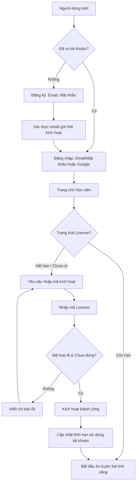
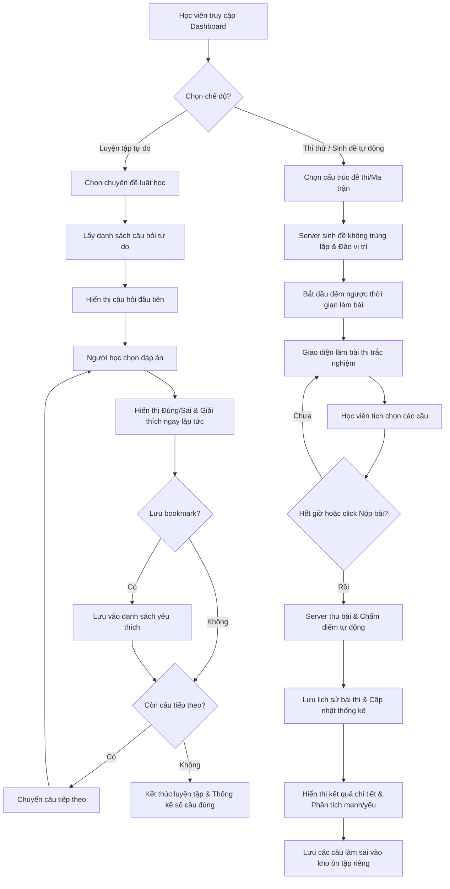
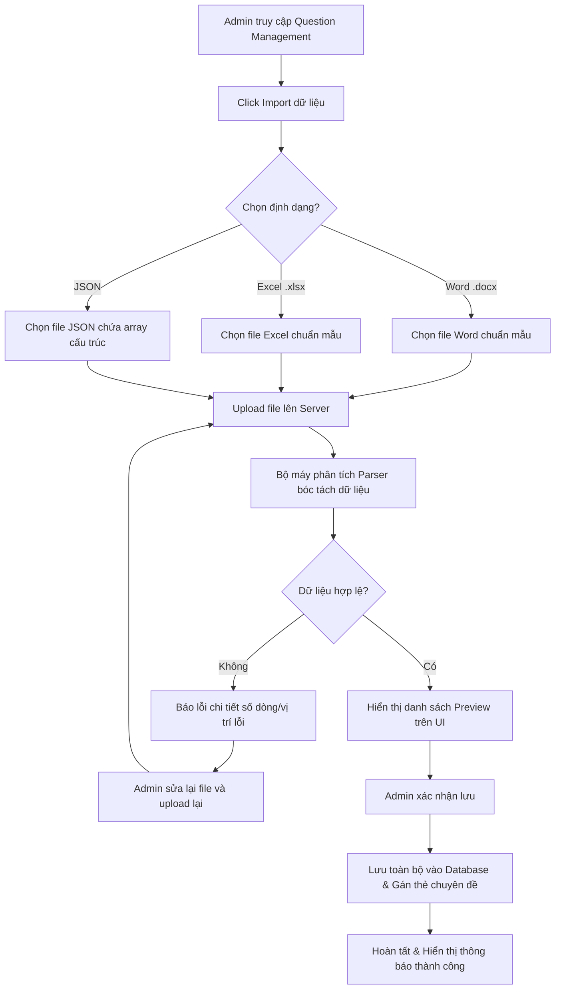
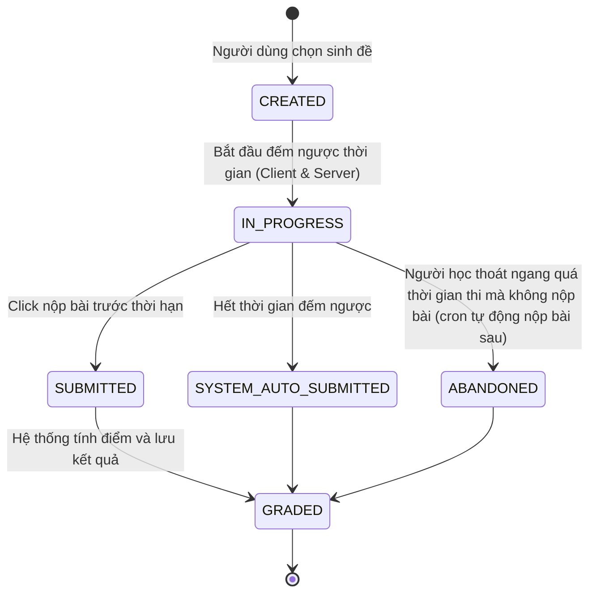

# 03. Luồng người dùng (User Flow & State Diagrams)

Tài liệu này mô phỏng các hành trình trải nghiệm của người dùng (User Journeys) và sơ đồ trạng thái (State Diagrams) của các thực thể quan trọng trong hệ thống.

---

## 3.1. Luồng Xác thực & Kích hoạt License (Auth & License Flow)

Sơ đồ dưới đây mô tả luồng từ khi người học đăng ký tài khoản mới cho đến khi kích hoạt mã License thành công để truy cập vào kho bài thi có phí.

---

## 3.2. Luồng Luyện tập & Thi thử của Người học (Exam Taking Flow)

Sơ đồ mô tả quy trình người học lựa chọn chế độ luyện tập hoặc thi thử có bấm giờ.

---

## 3.3. Luồng Import dữ liệu của Admin (Question Bank Import Flow)

Sơ đồ quy trình Admin chuẩn bị và tải lên tệp tin câu hỏi dạng Word/Excel.

---

## 3.4. Sơ đồ trạng thái Bài thi thử (Exam Attempt State Machine)

Trạng thái của một lượt thi thử (`ExamAttempt`) được theo dõi chặt chẽ để chống gian lận và tính toán đúng thời gian nộp bài.

